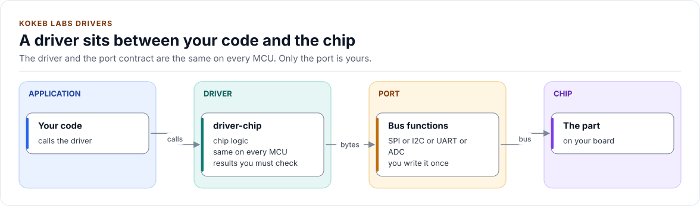
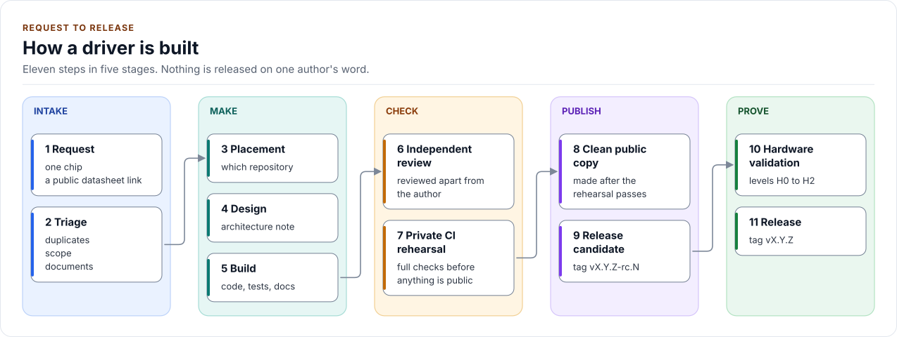
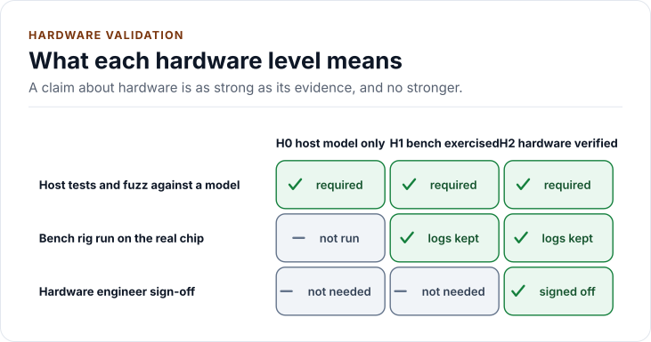

<picture>
  <source media="(prefers-color-scheme: dark)" srcset="https://raw.githubusercontent.com/kokeb-labs/.github/main/brand/mark/mark-dark.svg">
  
</picture>

# Kokeb Labs Drivers

Open C++ drivers for the chips on embedded boards, one repository per chip, each one small enough to read and
strict enough to trust. You give a driver a few functions that move bytes on your bus; it handles the chip, on any MCU.

The drivers are part of [Kokeb Labs](https://github.com/kokeb-labs). They are built from one template, checked by
the same CI, reviewed independently and held to one engineering standard.

<picture>
  <source media="(prefers-color-scheme: dark)" srcset="https://raw.githubusercontent.com/kokeb-labs-drivers/.github/main/profile/img/driver-layers.dark.svg">
  
</picture>

<!-- BEGIN GENERATED: summary -->
**22 public drivers.** All 22 are at a release candidate. Language standard today: C++20. Hardware level: 22 at H0.
<!-- END GENERATED: summary -->

## How a driver is built

Every driver takes the same road from a request to a release. Nothing skips a step, and the claim a release makes
about real hardware is stated as exactly as its evidence allows.

<picture>
  <source media="(prefers-color-scheme: dark)" srcset="https://raw.githubusercontent.com/kokeb-labs-drivers/.github/main/profile/img/driver-pipeline.dark.svg">
  
</picture>

Each request is tracked on the Driver pipeline board of [`driver-requests`](https://github.com/kokeb-labs-drivers/driver-requests),
where its stage (requested, triaged, datasheet acquired, in design, building, in review, released) is always visible.

### Hardware validation levels

A driver is first tested against a model of the chip written from the datasheet. That proves the code does what its
author understood, not what the chip does, so the level is stated per driver and never raised on opinion.

<picture>
  <source media="(prefers-color-scheme: dark)" srcset="https://raw.githubusercontent.com/kokeb-labs-drivers/.github/main/profile/img/hardware-levels.dark.svg">
  
</picture>

- **H0, host model only.** It passes the host tests, the fuzzer and the gates against a model of the chip. It has
  never run on the chip. Every new driver starts here.
- **H1, bench exercised.** A defined rig with the real chip ran the driver's example, and the logs and the rig
  description are kept.
- **H2, hardware verified.** A hardware engineer reviewed the rig against the datasheet and signed off.

A **release candidate** (`vX.Y.Z-rc.N`) is a complete, checked driver that is published so it can be tried and
validated. It is promoted to a full release when nothing fails, or replaced by the next candidate with the fixes.
Each driver's README says plainly which level it is at.

## The standard every driver meets

| | |
| --- | --- |
| **No surprises** | Header-only; no heap, exceptions, RTTI or virtual calls. Every call returns a result you must check |
| **Hardware-agnostic** | No MCU headers. The bus is a port class you write once; examples for ESP32 (ESP-IDF) and the host |
| **MISRA C++:2023 checked** | Every pull request runs the MISRA checks; each deviation is recorded with its reason |
| **Independent safety review** | Reviewed apart from the author's own checks: datasheet conformance, fault handling, safe outputs |
| **Tested and fuzzed** | Host tests against a protocol model of the chip; a fuzzer corrupts the chip's replies |
| **Honest about hardware** | One validation level (H0, H1 or H2) per driver, with the evidence for it |
| **Documented** | Datasheet-backed docs with chip pinout, block and wiring diagrams, an API reference and stated limits |
| **MIT licensed** | Use it in open or closed products. Names, namespaces and macros follow the chip, never a brand |

### Which language standard

The drivers are C++20 today and are meant to move up over time. The standard is not hard-wired into the
organization: each driver's build files state the one it needs, and the catalogue below reads it from there, so it
always shows what the driver says now.

## Drivers

Grouped by function. Every cell below is generated from the driver's own repository (its description, `driver.yml`,
build files and latest release) by [`tools/gen_profile.py`](tools/gen_profile.py), never edited by hand.

<!-- BEGIN GENERATED: catalogue -->
### Analog-to-digital converters

| Driver | Chip or device | Bus | Standard | Latest release | Hardware |
| --- | --- | --- | --- | --- | --- |
| [`driver-ads7952`](https://github.com/kokeb-labs-drivers/driver-ads7952) | TI ADS7950/51/52/53 12-bit 4/8/12/16-channel SPI ADCs | SPI | C++20 | `v0.1.0-rc.1` (release candidate) | H0 host model |
| [`driver-ads9324`](https://github.com/kokeb-labs-drivers/driver-ads9324) | TI ADS9324 16-channel, 16-bit, 1 MSPS simultaneous-sampling SAR ADC with integrated PGA and SPI interface | SPI | C++20 | `v0.1.0-rc.1` (release candidate) | H0 host model |

### Position and motion sensing

| Driver | Chip or device | Bus | Standard | Latest release | Hardware |
| --- | --- | --- | --- | --- | --- |
| [`driver-as5047u`](https://github.com/kokeb-labs-drivers/driver-as5047u) | ams OSRAM AS5047U 14-bit magnetic rotary position sensor (SPI) | SPI | C++20 | `v0.1.0-rc.1` (release candidate) | H0 host model |
| [`driver-bno08x`](https://github.com/kokeb-labs-drivers/driver-bno08x) | Hillcrest Labs / CEVA BNO08x family of 9-axis orientation sensors over SHTP, with I2C, SPI and UART-RVC transports | I2C, SPI, UART | C++20 | `v0.1.0-rc.1` (release candidate) | H0 host model |

### Motor and servo control

| Driver | Chip or device | Bus | Standard | Latest release | Hardware |
| --- | --- | --- | --- | --- | --- |
| [`driver-tmc5160`](https://github.com/kokeb-labs-drivers/driver-tmc5160) | Trinamic TMC5160 and TMC5160A stepper motor controller and driver with SPI and UART interfaces | SPI, UART | C++20 | `v0.1.0-rc.1` (release candidate) | H0 host model |
| [`driver-tmc9660`](https://github.com/kokeb-labs-drivers/driver-tmc9660) | TMC9660 servo controller and gate driver (bootloader, parameter mode and register mode over SPI or UART) | SPI, UART | C++20 | `v0.1.0-rc.1` (release candidate) | H0 host model |
| [`driver-dynamixel`](https://github.com/kokeb-labs-drivers/driver-dynamixel) | ROBOTIS DYNAMIXEL servos, protocols 1.0 and 2.0, over a half-duplex UART | UART | C++20 | `v0.1.0-rc.1` (release candidate) | H0 host model |

### Fieldbus and communication

| Driver | Chip or device | Bus | Standard | Latest release | Hardware |
| --- | --- | --- | --- | --- | --- |
| [`driver-canopen-client`](https://github.com/kokeb-labs-drivers/driver-canopen-client) | CANopen client driver: NMT master, SDO, heartbeat, EMCY, PDO and a CiA 402 drive state machine over a CAN frame port | CANopen | C++20 | `v0.1.0-rc.1` (release candidate) | H0 host model |

### Solenoid, valve and power

| Driver | Chip or device | Bus | Standard | Latest release | Hardware |
| --- | --- | --- | --- | --- | --- |
| [`driver-max22200`](https://github.com/kokeb-labs-drivers/driver-max22200) | Analog Devices MAX22200 octal solenoid and motor driver (SPI) | SPI | C++20 | `v0.1.0-rc.1` (release candidate) | H0 host model |
| [`driver-tle92466ed`](https://github.com/kokeb-labs-drivers/driver-tle92466ed) | Infineon TLE92466ED six-channel low-side solenoid driver (SPI) | SPI | C++20 | `v0.1.0-rc.1` (release candidate) | H0 host model |
| [`driver-pf1550`](https://github.com/kokeb-labs-drivers/driver-pf1550) | NXP PF1550 power management IC: single-cell Li-ion linear charger, three buck regulators and three LDOs, on I2C | I2C | C++20 | `v0.1.0-rc.1` (release candidate) | H0 host model |

### GPIO, PWM and LEDs

| Driver | Chip or device | Bus | Standard | Latest release | Hardware |
| --- | --- | --- | --- | --- | --- |
| [`driver-pcal9555`](https://github.com/kokeb-labs-drivers/driver-pcal9555) | NXP PCA9555 and PCAL9555A 16-bit I2C GPIO expanders | I2C | C++20 | `v0.1.0-rc.1` (release candidate) | H0 host model |
| [`driver-pca9685`](https://github.com/kokeb-labs-drivers/driver-pca9685) | NXP PCA9685 16-channel 12-bit PWM controller (I2C) | I2C | C++20 | `v0.1.0-rc.1` (release candidate) | H0 host model |
| [`driver-ws2812-rmt`](https://github.com/kokeb-labs-drivers/driver-ws2812-rmt) | single-wire addressable RGB and RGBW LEDs (WS2812, SK6812 and compatible) over a timed bit stream, with an ESP32 RMT port | PIO (ESP32 only) | C++20 | `v0.1.0-rc.1` (release candidate) | H0 host model |

### Memory

| Driver | Chip or device | Bus | Standard | Latest release | Hardware |
| --- | --- | --- | --- | --- | --- |
| [`driver-at25040b`](https://github.com/kokeb-labs-drivers/driver-at25040b) | Microchip AT25010B/020B/040B SPI serial EEPROMs | SPI | C++20 | `v0.1.0-rc.1` (release candidate) | H0 host model |

### Display and buttons

| Driver | Chip or device | Bus | Standard | Latest release | Hardware |
| --- | --- | --- | --- | --- | --- |
| [`driver-isf15acp4`](https://github.com/kokeb-labs-drivers/driver-isf15acp4) | NKK SmartDisplay OLED pushbuttons and displays (ISF15ACP4, ISC15ANP4, ISC01P) over SPI | SPI | C++20 | `v0.1.0-rc.1` (release candidate) | H0 host model |

### Temperature, pressure, flow and gas sensors

| Driver | Chip or device | Bus | Standard | Latest release | Hardware |
| --- | --- | --- | --- | --- | --- |
| [`driver-bmp581`](https://github.com/kokeb-labs-drivers/driver-bmp581) | Bosch BMP581 barometric pressure and temperature sensor (I2C, SPI) | I2C, SPI | C++20 | `v0.1.0-rc.1` (release candidate) | H0 host model |
| [`driver-mcp9700`](https://github.com/kokeb-labs-drivers/driver-mcp9700) | Microchip MCP9700, MCP9700A, MCP9701 and MCP9701A analog temperature sensors (ADC) | ADC | C++20 | `v0.1.0-rc.1` (release candidate) | H0 host model |
| [`driver-ntc-thermistor`](https://github.com/kokeb-labs-drivers/driver-ntc-thermistor) | NTC thermistors on an ADC, any part: B-parameter, Steinhart-Hart and lookup tables | ADC | C++20 | `v0.1.0-rc.1` (release candidate) | H0 host model |
| [`driver-sfm-flow-meter`](https://github.com/kokeb-labs-drivers/driver-sfm-flow-meter) | Sensirion SFM family of I2C mass flow meters (SFM3000 to SFM6000D) | I2C | C++20 | `v0.1.0-rc.1` (release candidate) | H0 host model |
| [`driver-alicat-basis2`](https://github.com/kokeb-labs-drivers/driver-alicat-basis2) | Alicat BASIS 2 gas mass flow meters and controllers (B and BC series) over serial, with the ASCII protocol and Modbus RTU | UART, Modbus | C++20 | `v0.1.0-rc.1` (release candidate) | H0 host model |
| [`driver-fdo2`](https://github.com/kokeb-labs-drivers/driver-fdo2) | PyroScience FDO2 optical oxygen sensor modules on UART | UART | C++20 | `v0.1.0-rc.1` (release candidate) | H0 host model |
<!-- END GENERATED: catalogue -->

Ports for common MCU families and a shared core that joins drivers to them are coming; they are not public yet.
Until then, a driver needs only the small port class you write for your bus.

## Request a driver

Need a chip that is not listed? Open a form in [`driver-requests`](https://github.com/kokeb-labs-drivers/driver-requests):

- [Request a driver](https://github.com/kokeb-labs-drivers/driver-requests/issues/new?template=request-driver.yml)
  for a chip that has none. One chip per request, with a link to the datasheet on the vendor's own website.
- [Request a port or target](https://github.com/kokeb-labs-drivers/driver-requests/issues/new?template=request-port.yml)
  for an MCU family, SDK or RTOS.
- [Report a datasheet erratum](https://github.com/kokeb-labs-drivers/driver-requests/issues/new?template=datasheet-erratum.yml)
  when a chip does not do what its datasheet says.

Add a thumbs-up to a request you want; that is the vote. Simpler chips with complete public documents go first.

## Contribute

Read the [contributing guide](https://github.com/kokeb-labs-drivers/.github/blob/main/CONTRIBUTING.md). For a bug in
a driver, use that driver's repository. If you can test on real hardware, say so on the request or the driver: a run
on a bench rig is what moves a driver from H0 to H1. Every commit is signed off (`git commit -s`).

## Where things live

| | |
| --- | --- |
| [`driver-requests`](https://github.com/kokeb-labs-drivers/driver-requests) | Ask for a driver, a port or a datasheet fix; follow it on the Driver pipeline board |
| [`driver-template`](https://github.com/kokeb-labs/driver-template) | Start a new driver: one command gives code, host tests, an ESP32 example, docs and CI |
| [`ci-tools`](https://github.com/kokeb-labs/ci-tools) | The reusable workflows and the documentation tooling every driver uses |
| [Handbook](https://kokeb-labs.github.io/handbook/) | Every rule for C++, CMake, docs, CI and reviews, with the check that verifies it |
| [Kokeb Labs portal](https://kokeb-labs.github.io/) | Projects, how we build, roadmap and contributing |

Questions and ideas go to [Discussions](https://github.com/kokeb-labs-drivers/.github/discussions). Report
vulnerabilities privately as the [security policy](https://github.com/kokeb-labs-drivers/.github/blob/main/SECURITY.md)
describes, never in a public issue.
