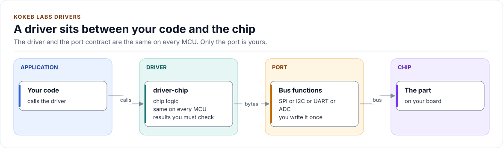
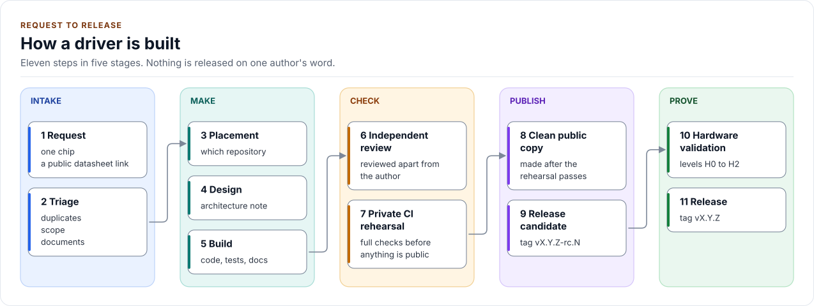
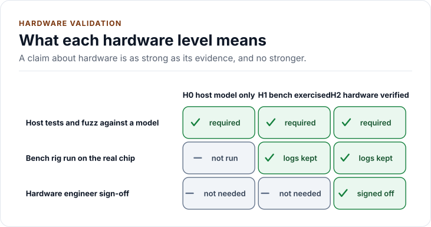

# Figures

<!-- Written by kokeb-docs figures from docs/diagrams/figures/*.py. Do not edit by hand. -->

Every figure on this site is drawn by a Python module from facts extracted from the code, so it is rebuilt,
not redrawn, when the code changes. CI runs `kokeb-docs figures --check` and fails when a
committed figure no longer matches the code. Each figure below lists the files it is drawn from.

## A driver sits between your code and the chip

<!-- figure: driver-layers -->
<picture>
  <source media="(prefers-color-scheme: dark)" srcset="driver-layers.dark.svg">
  
</picture>
<!-- /figure -->

Hardware description: [`docs/model/driver-layers.pipeline.yml`](../model/driver-layers.pipeline.yml)

Drawn from:

- [`docs/model/driver-layers.pipeline.yml`](../model/driver-layers.pipeline.yml)

## How a driver is built

<!-- figure: driver-pipeline -->
<picture>
  <source media="(prefers-color-scheme: dark)" srcset="driver-pipeline.dark.svg">
  
</picture>
<!-- /figure -->

Hardware description: [`docs/model/driver-pipeline.pipeline.yml`](../model/driver-pipeline.pipeline.yml)

Drawn from:

- [`docs/model/driver-pipeline.pipeline.yml`](../model/driver-pipeline.pipeline.yml)

## What each hardware level means

<!-- figure: hardware-levels -->
<picture>
  <source media="(prefers-color-scheme: dark)" srcset="hardware-levels.dark.svg">
  
</picture>
<!-- /figure -->

Hardware description: [`docs/model/hardware-levels.matrix.yml`](../model/hardware-levels.matrix.yml)

Drawn from:

- [`docs/model/hardware-levels.matrix.yml`](../model/hardware-levels.matrix.yml)
